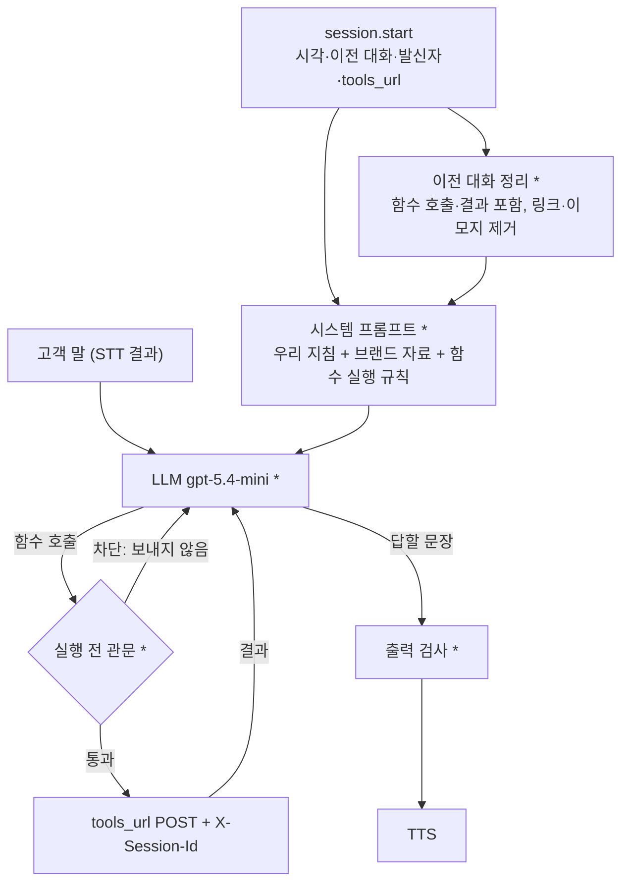

# LLM·함수: 실행 전 관문과 규칙 묶음 (팀원용 안내)

브랜치 `feature/llm-gate-v2` (`prototype` 기준) · 담당 유주연 · 2026-11-21

> 11/19 버전(`feature/llm-gate`)은 이미 `prototype`에 합쳐져 있다. 이 문서는 11/21 당일 키트에 맞춘 수정이다.
> 차별화·성능 개선은 하지 않았다. **지침과 제출 조건을 지키며 정상 동작하는 기본**만 맞췄다.

## 한 줄 요약

공식 함수 8개와 공식 대화 형식에 맞췄다. 실제 상담 기록처럼 **고객이 값이나 선택을 말한 그 턴에 바로 접수**하되, 값이 없거나 대화에 근거가 없거나 망설이면 코드가 막는다. 브랜드 자료(시나리오·브랜드 정보·말투)를 프롬프트에 붙였다. 키트 데이터는 git에 올리지 않는다.

## 흐름



`*` = 이번에 고친 곳. 차단되면 함수 서버로 아무것도 가지 않고, 모델은 `not_executed`와 이유를 받아 고객에게 필요한 것을 묻는다.

### 실행 전 관문이 보는 것 (공식 묶음)

| 순서 | 검사 | 막는 예 |
|---|---|---|
| 0 | 필요한 값이 있는가 (조회는 주문번호·전화번호 중 하나, 접수는 규칙에 적힌 값 전부). "고객님", "없음", "발신자 정보 없음" 같은 자리표시 값은 없는 것으로 본다 | 번호 없이 주문 조회, 이름을 모르는데 `customer_name="고객님"`으로 전화 요청 |
| 1 | 접수 함수의 번호 형식 (주문번호 8+7자리, 상세주문번호 +2자리, 전화번호) | 사진 속 송장번호를 주문번호로 넣음 |
| 2 | 값이 대화에 나왔는가: 이번 말, 이전 대화(함수 결과 포함), 발신자 정보 | 지어낸 번호 |
| 2' | 접수 함수의 번호가 **이번 턴에 처음 조회한 결과에만** 있으면 막음 | 조회하자마자 고객 확인 없이 반품 접수 |
| 3 | 접수 함수: 거절·보류("잠깐만요", "아니요"), 되묻기("네?")가 없고, 요청 근거가 대화에 있는가 | 배송 문의 중에 취소 접수 |

규칙은 `team/agent/packs/official/rules.json` 한 곳에 있고, 프롬프트의 [함수 실행 규칙]도 이 파일에서 만들어진다.

## 무엇을 왜 고쳤나

| 문제 (당일 키트 기준) | 고친 것 | 파일 |
|---|---|---|
| 공식 이전 대화에 `tool_call`·`tool_result`가 섞이면 해석 실패 → 이력이 JSON째로 들어가고 관문은 근거를 못 찾음 | 함수 항목을 한 줄로 바꾸고, 링크·이모지 제거. 길이로는 자르지 않음(예전의 3,000자 자르기 삭제) | `policy.py` |
| 관문이 "상담원이 값을 다시 읽고 '네'를 받은 뒤"만 허용 → 실제 상담처럼 바로 접수하는 문항이 막힘 | 공식 묶음은 대화 맥락 모드(`confirm: "context"`). 연습 묶음의 기존 모드는 그대로 | `gate.py`, `rules.json` |
| 규칙에 없는 함수(반품 현황 조회, 상품 검색)를 쓰기 함수로 취급 | 공식 함수 8개 전부 규칙에 적음 | `rules.json` |
| 출력 검사가 구분자를 건너 숫자를 이어 붙여 "1·2·4·8박스"를 하나의 긴 번호로 오인 | 숫자를 구분자 단위로 읽음 | `output_guard.py` |
| 출력 검사가 회사의 연락 안내("업무 시간 안에 순서대로 연락드립니다")까지 시간 약속으로 바꿈 | 고객이 직접 말한 시간을 확정처럼 되풀이할 때만 검사 | `output_guard.py`, `dialog.py` |
| 모델이 함수 호출을 글자로 써 버림(`search_products({"query": …})`) → TTS가 코드를 읽음 | 출력 검사가 함수 호출 모양 글자를 지움 | `output_guard.py` |
| 모델이 함수를 부르지 않고 "접수해 두었습니다"라고 말함, 고객이 불러 준 주문 정보를 조회 없이 그대로 안내 | 지침: 결과가 ok이기 전에는 접수했다고 말하지 않기, 상태는 조회 결과로 안내 | `packs/official/prompt.md`, `policy.py` |
| 프롬프트가 연습용, 브랜드 자료 없음 | 공식 묶음 지침 + 키트 `data/brand`를 시작할 때 붙임 | `packs/official/`, `server.py` |
| 기본 LLM gpt-4.1, `openai/` 접두어가 붙으면 추론 모델 인식 실패 | 기본 `gpt-5.4-mini`, 접두어 무시 | `config.py`, `providers/llm.py` |
| 공식 문항으로 확인할 도구 없음 | `llm_cases`: 연습 문항을 글자로 돌려 채점기와 같은 규칙으로 함수 점수 계산 | `scripts/llm_cases.py` |

## 확인한 숫자 (연습 문항 80개)

| 항목 | 고치기 전 (`prototype`) | 고친 뒤 |
|---|---|---|
| 정답 함수 호출 45개 중 관문 통과 | 14 | 44 (막힌 1개는 주문번호가 대화 어디에도 없는 문항) |
| 이전 대화 해석 실패 (이력 있는 44문항 중) | 16 | 0 |
| 정답 답변 중 출력 검사가 바꿔 버리는 문장 | 18 | 0 |
| 함수 점수 (LLM까지, OpenRouter gpt-5.4-mini, 글자 입력) | 측정 안 함 | 91~95 (5회, 아래) |

함수 점수는 음성·STT 없이 고객 말 원문을 넣은 값이다. 실제 측정은 STT 오류와 응대 점수(gpt-5.5 판정)가 더해진다.
처음 3회(91.2 / 92.5 / 93.8)는 연습 도구가 정답 기록의 함수 결과를 `{"name", "result"}` 포장째 돌려주던 때의 값이고, 고친 뒤 4·5회차는 95.0 / 91.2였다. 회차마다 틀리는 문항이 달라지는 것은 모델 답이 매번 달라서다(아래 "남겨 둔 것").

## 속도 측정에서 알아 둘 것

측정기(`eval/run_eval.py`)는 첫 소리를 "말 끝 → 첫 음성"으로만 잰다. 그래서 **함수를 부르기 전에 아무 말도 하지 않으면, 중계가 맞추는 함수 응답 시간(0.8~1.5초)이 첫 소리 시간에 그대로 들어간다.** SCORING.md에는 "어느 지표에도 들어가지 않는다"고 되어 있지만 코드는 그렇다. 조회 뒤 답은 마지막 함수 응답 시각부터 잰다.
예: 반품 접수 문항 하나를 추적한 결과, 말 끝 판단 약 1.1초 + LLM 1회차 1.4초 + 중계 1.5초 + LLM 2회차 첫 글자 1.1초 + TTS 약 0.9초로 첫 소리는 약 6초, 조회 뒤 답은 약 2초였다. 말 끝 판단과 TTS는 예전 모델로 잰 값이다.
대기 멘트(`AGENT_TOOL_ACK`)를 켜면 첫 소리가 크게 줄지만, 대회 사이트는 채움말로 점수만 높이는 설계를 지양하라고 한다. 켤지는 팀이 정한다.

## 팀원에게 미치는 영향

- **기본 묶음이 공식 묶음으로 바뀌었다.** 연습 묶음이 필요한 테스트는 `practice_config()`를 쓴다(테스트는 이미 바꿈).
- **키트를 저장소 루트에 풀면 `data/` 아래 대회 데이터는 git에서 빠진다**(`.gitignore`). 제출 압축 파일에는 들어간다.
- 음성 쪽(STT·TTS·말 끝 판단)과 모의 함수 서버는 건드리지 않았다. 아래는 담당자 확인이 필요하다.
  - STT 기본 모델 `stt-rt-v4` → 공식 `stt-rt-v6`, Soniox 인증은 `Authorization: Bearer` 헤더(대회 사이트 예제)
  - TTS 기본 모델 → 공식 `gemini-3.8-flash-lite-tts`
  - 모의 함수 서버를 SPEC.md 규칙으로: 조회는 하이픈·공백 무시, 접수는 필수 값으로 ok/invalid, 검색은 가장 가까운 기록, 없으면 not_found

## 직접 돌려 보기

```bash
.venv/Scripts/python -m pytest team/tests -q                                        # 키 없이
.venv/Scripts/python -m team.scripts.llm_cases --kit <키트 폴더> --gate-only         # 키 없이
.venv/Scripts/python -m team.scripts.llm_cases --kit <키트 폴더> --limit 20          # LLM 키 사용
```

`llm_probe`는 연습용 문항(K·G)을 연습 묶음으로 돌리는 도구로 남겨 두었다.
LLM 키는 `.env`에 둔다. OpenRouter로 시험할 때는 `AGENT_LLM_BASE_URL`, `AGENT_LLM_API_KEY_ENV`, `AGENT_LLM_MODEL=openai/gpt-5.4-mini`를 넣는다(추론 모델 설정은 이제 자동).

## 일부러 남겨 둔 것 (차별화·성능 개선 영역)

- 인계(Human Handoff) 기준: 지금은 시나리오를 따르라는 지침과 인계 신호 메모뿐이다. 팀이 기준을 정해야 한다.
- 이전 대화 길이: 지금은 하나도 자르지 않는다(연습 문항 최대 약 5천 자). 길이만 보고 자르면 끝부분의 제조번호·주문번호 같은 정보가 사라지므로, 아주 긴 이력이 첫 응답을 늦출 때 내용 기준으로 줄이는 방법을 정한다.
- 모델이 매번 다르게 답하는 문제: 같은 문항에서 전화 요청을 부르지 않고 "접수해 두었습니다"라고 말한 적이 있다(실행마다 0~3건). 지침은 넣었고, 더 확실히 하려면 코드 쪽 장치가 필요하다(예: 접수 함수 없이 접수했다는 문장이 나오면 말하기 전에 붙잡고 한 번 더 돌리기. 지연이 늘어 설계 판단이 필요).
- 전체 반품과 일부 반품 고르기, 번호 없이 조회부터 시도하는 습관(관문이 막지만 한 번 더 돈다).
- 번호·날짜·금액을 코드가 채우기(슬롯 방식): 모델은 값 자리에 이름만 쓰고(예: `{주문1.배송완료일자}`), 코드가 이번 조회 결과·발신자 정보·이전 대화의 실제 값을 말하기 좋은 형식("1월 4일", 주문번호 끝 4자리 등)으로 채운다.
  - 왜: 자료가 프롬프트에 있어도 모델이 틀린 사례가 있다. 발신자 번호를 한글 숫자로 읽다가 틀림(팀 실험), 다른 번호를 주문번호 칸에 넣음, 여러 날짜 칸 중 엉뚱한 것을 고를 위험.
  - 지금 출력 검사는 9자리 이상 번호가 자료 어디에도 없을 때만 의미 있게 막는다. 브랜드 정보에 숫자가 많아서 짧은 숫자는 거의 다 통과하고(4회 실행에서 0건), 자료에 있는 다른 번호를 고른 경우는 못 잡는다.
  - 좋은 점: 값이 결과와 글자 하나까지 같다. 숫자 읽기 형식을 한 곳에서 정하므로 TTS 숫자 읽기 문제도 함께 풀린다. 없는 칸을 쓰면 바로 알 수 있다.
  - 정할 것: 칸 이름 규칙(주문 여러 건일 때 번호 붙이기), 모델이 값을 직접 썼을 때의 처리(지금 검사 유지), 채울 수 없는 칸이 나왔을 때 말할 문장, 숫자별 말하기 형식(음성 담당과 함께). 확인 질문을 코드가 하는 연습 규칙의 `confirm_template`이 같은 생각의 작은 예다.
  - 정책 문장을 지어 붙이는 문제는 이 방식으로 막지 못한다(아래 항목).
- 브랜드 정보와 다른 정책 문장: 출력 검사는 숫자·시간·반복·코드 모양만 본다. 반품 문항 추적에서 모델이 브랜드 정보의 반품 정책에 없는 조건("검수 결과에 따라 환불이 달라질 수 있다")을 붙였는데 걸러지지 않았다. 응대 점수(사실관계) 개선 영역이다.
- 속도: 함수 문항의 첫 문장이 LLM만으로 중앙값 2.3초 정도(OpenRouter 경유). 채움말, 프롬프트 길이(브랜드 정보 전체 약 2만 자) 줄이기 등은 측정 후 정한다.
- 기존 보류 목록은 [LLM_BACKLOG.md](LLM_BACKLOG.md)에 있다.
